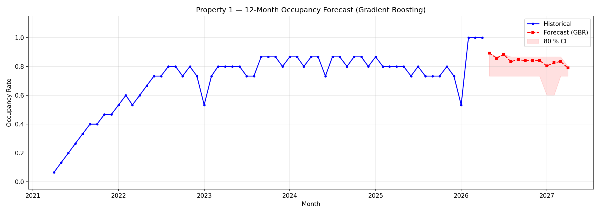

# MPsan TMS: Tenant Management System

A full-stack web app for a rental property business to run day-to-day operations: tenants, rooms, rent, reminders, documents and reports, across multiple properties.


| | |
|---|---|
| **What it is** | Tenant and rent management system built for MPsan Properties |
| **Stack** | React 19 + Vite + Tailwind CSS 4 / Django 6 + DRF + Channels / PostgreSQL / Docker + Nginx |
| **Size** | ~10k lines of Python backend, ~26k lines of React frontend, 26 data models, 80+ API routes |
| **Highlights** | JWT auth with 2FA and session management, real-time WebSocket updates, web push, SMS and email reminders, two ML models |


*12-month occupancy forecast for one property, produced by the Gradient Boosting model in `Backend/api/ml/`.*

## Features

**Property and tenant management**
- Multiple properties, each with sections and units, shown as a room map and a room list
- Full tenant lifecycle: move-in, lease, other occupants, appliances, room transfers, move-out
- Tenant documents (uploads with type and size checks)
- CSV import and export

**Payments**
- Rent recording, payment history, balances and receivables
- Batch rent entry and a preferred payment day per tenant
- PDF reports generated in the browser (jsPDF)

**Communication**
- Automated rent reminders by SMS (SMS gateway) and email (SMTP)
- Mass messaging to tenants
- Web push notifications (VAPID) and live in-app updates over WebSockets (Django Channels)

**Security**
- JWT authentication with role-based access (owner, manager, staff)
- Two-factor login codes and trusted devices
- Active session list with remote logout, failed-login tracking, account lockout and security alerts
- Audit log of critical actions

**Machine learning** (`Backend/api/ml/`)
- **Reminder timing:** a Random Forest model predicts the hour each tenant is most likely to pay, so reminders go out at that time. Retrained weekly by a management command.
- **Occupancy forecasting:** a Gradient Boosting model forecasts each property's occupancy rate for the next 12 months from move-in and move-out history, shown on the dashboard.

## Architecture

```
Browser (React SPA, PWA)
   │  HTTPS /api   WebSocket /ws
   ▼
Nginx (serves the built SPA, proxies /api and /ws)
   ▼
Daphne ASGI ── Django REST Framework (HTTP)
            └─ Django Channels (WebSocket)
   ▼
PostgreSQL
```

All three services run from one `docker-compose.yml`.

## Project structure

```
MPsan-TMS/
├── Backend/
│   ├── MPsanBackend/        Django settings, ASGI/WSGI entry points
│   ├── api/
│   │   ├── models.py        26 models (tenants, units, payments, sessions, audit logs, ...)
│   │   ├── views/           endpoints split by area: auth, tenants, payments, messaging, ml_forecast, ...
│   │   ├── consumers.py     WebSocket consumers
│   │   ├── ml/              ML pipelines, training scripts and model notes
│   │   └── management/      scheduled commands (retrain model, update reminder schedules)
│   ├── Dockerfile
│   └── requirements.txt
├── FrontEnd/
│   ├── src/components/      dashboard, room map, tenant profile, reports, settings, ...
│   ├── public/              PWA manifest and service worker
│   ├── nginx.conf
│   └── Dockerfile
├── docker-compose.yml
└── .env.example
```

## Running it

### With Docker (recommended)

```bash
git clone https://github.com/Ranto0422/MPsan-TMS.git
cd MPsan-TMS
cp .env.example .env    # then fill in the values
docker compose up --build
```

Open http://localhost:8080.

### Without Docker

Requires Python 3.12+, Node.js 20+ and PostgreSQL 15+.

```bash
# Backend
cd Backend
cp .env.example .env
python -m venv .venv
source .venv/bin/activate        # Windows: .venv\Scripts\activate
pip install -r requirements.txt
python manage.py migrate
python manage.py createsuperuser
python manage.py runserver
```

```bash
# Frontend (in a second terminal)
cd FrontEnd
npm install
npm run dev
```

## Environment variables

See [.env.example](.env.example) for the full list.

| Variable | Purpose |
|---|---|
| `POSTGRES_DB`, `POSTGRES_USER`, `POSTGRES_PASSWORD` | Database credentials |
| `DJANGO_SECRET_KEY` | Django secret key, also used to sign JWTs |
| `CORS_ALLOWED_ORIGINS` | Allowed browser origins |
| `VAPID_PUBLIC_KEY`, `VAPID_PRIVATE_KEY` | Web push keys |
| `SMS_GATEWAY_USERNAME`, `SMS_GATEWAY_PASSWORD`, `SMS_GATEWAY_URL` | SMS reminders |
| `EMAIL_HOST_USER`, `EMAIL_HOST_PASSWORD` | SMTP account for email reminders |

## License

Proprietary. All rights reserved.
